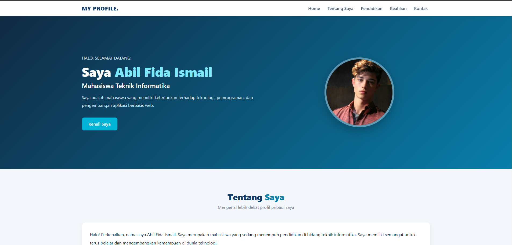

# Website Profil Mahasiswa

Website Profil Mahasiswa merupakan project website sederhana satu halaman (*single page website*) yang dibuat menggunakan HTML5, CSS3, Bootstrap 5, dan JavaScript.

Project ini dibuat untuk memenuhi tugas praktikum pemrograman web dengan tema profil mahasiswa.

## Preview Website

Berikut merupakan tampilan website profil mahasiswa:



## Identitas Mahasiswa

- **Nama:** Nama Lengkap Anda
- **NIM:** NIM Anda
- **Program Studi:** Nama Program Studi
- **Mata Kuliah:** Pemrograman Web

## Teknologi yang Digunakan

1. **HTML5** — Membuat struktur halaman website.
2. **CSS3** — Mengatur desain, warna, layout, dan animasi.
3. **Bootstrap 5** — Membuat tampilan website responsif.
4. **JavaScript** — Membuat fitur interaktif pada website.

## Fitur Website

Website ini memiliki beberapa bagian utama:

- Navigation Bar: Menu navigasi untuk berpindah antarbagian halaman.
- Hero Section: Menampilkan foto profil, nama, dan deskripsi singkat mahasiswa.
- Tentang Saya: Menampilkan informasi dan deskripsi pribadi.
- Pendidikan: Menampilkan riwayat pendidikan.
- Keahlian: Menampilkan keterampilan dan teknologi yang dipelajari.
- Kontak: Menampilkan pesan interaktif menggunakan JavaScript.
- Responsive Design: Tampilan menyesuaikan ukuran layar perangkat.

## Fitur JavaScript

Website memiliki tombol interaktif **Tampilkan Pesan**.

Ketika tombol diklik, website akan menampilkan pesan ucapan terima kasih beserta tanggal dan waktu kunjungan.

## Struktur Project

```text
profil-mahasiswa/
│
├── index.html
├── README.md
│
└── images/
    ├── foto-profil.jpg
    └── screenshot-website.png
```

## Cara Menjalankan Website

1. Download atau clone repository ini.
2. Buka folder project menggunakan Visual Studio Code.
3. Buka file `index.html`.
4. Jalankan menggunakan browser seperti Google Chrome.

Pastikan perangkat terhubung ke internet agar Bootstrap CDN dapat dimuat.

## Hosting Website

Website ini dipublikasikan menggunakan GitHub Pages.

**Link Website:** Akan ditambahkan setelah proses hosting selesai.

## Kesimpulan

Project ini merupakan implementasi dasar pengembangan website menggunakan HTML, CSS, Bootstrap, dan JavaScript. Melalui project ini, mahasiswa dapat memahami struktur HTML, penggunaan framework Bootstrap, pengaturan tampilan menggunakan CSS, serta penerapan interaksi sederhana menggunakan JavaScript.

---

**Dibuat sebagai bagian dari tugas praktikum Pemrograman Web.**